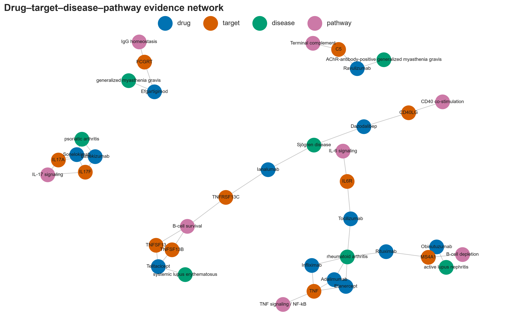
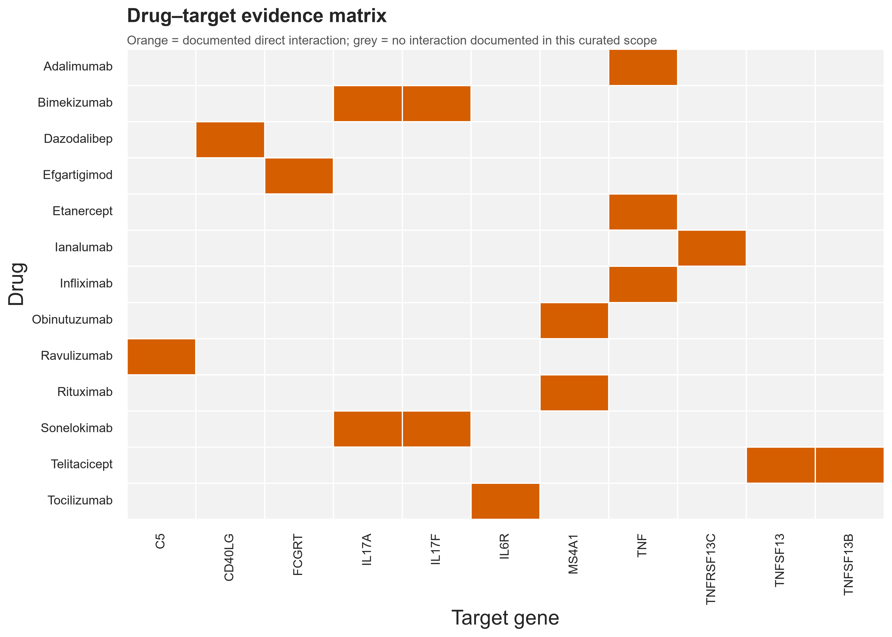
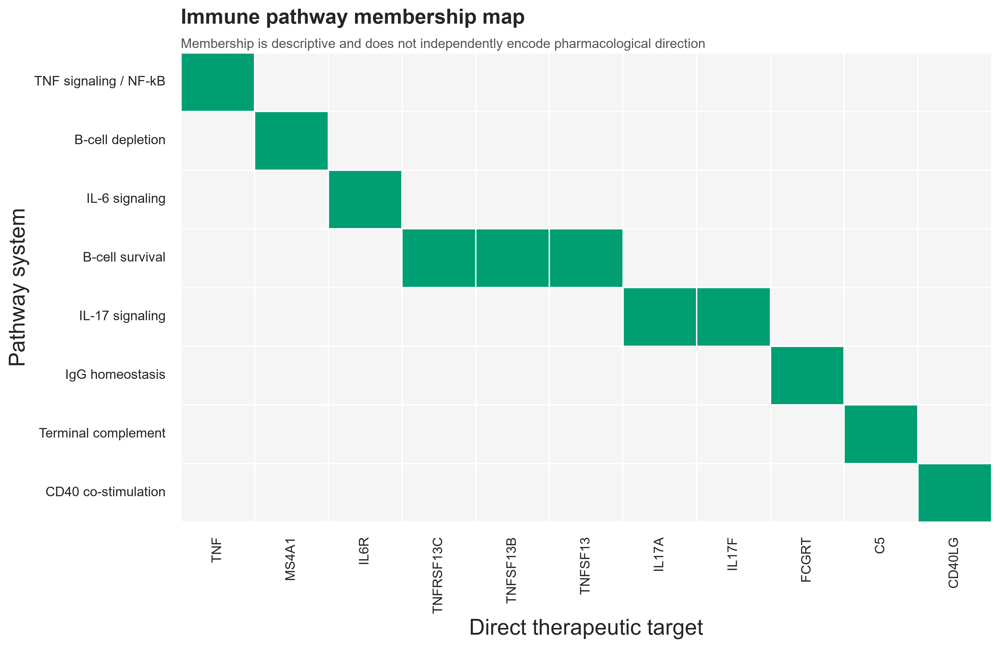

# Therapeutic Target Landscape of Biologic Drugs in Autoimmune Disease

**Author: Tharuniya Anpalakan**

An evidence-audited computational immunopharmacology project mapping biologic drugs to direct molecular targets, autoimmune indications, immune pathways and selected clinical studies. The repository converts a coursework-derived topic into an independent, reproducible analysis; the original document remains unchanged in a private, Git-ignored directory.



## Research overview

Targeted biologics act through materially different mechanisms: TNF or IL-17 ligand neutralization, IL-6 or BAFF-receptor blockade, CD20-directed cell depletion, soluble receptor trapping, FcRn blockade, terminal complement inhibition and CD40L antagonism. This project asks how those mechanisms and their evidence can be represented without collapsing approval, investigation, pathway association and clinical efficacy into one label.

The curated v1.0 landscape contains **13 biologics, 11 direct human protein targets, 16 verified direct drug–target relations and 10 selected clinical studies**. Its heterogeneous network contains **39 nodes and 40 typed edges**.

## Scientific background

TNF signaling helped establish the clinical logic of selective cytokine intervention, but autoimmune diseases do not share one dominant mechanism. B-cell survival and depletion are important in selected humoral diseases; IL-17A/F participate in psoriatic inflammation; FcRn sustains circulating IgG; C5 enables terminal complement injury; and CD40–CD40L supports T–B-cell communication. The project preserves these distinctions and treats tissue biomarkers as investigational selection tools rather than validated companion diagnostics.

## Research questions

The primary question is: *How can the molecular targets, immune pathways and clinical evidence of established and emerging biologic therapies for autoimmune diseases be systematically mapped and compared using reproducible computational methods?* Detailed objectives are in [docs/research_questions.md](docs/research_questions.md).

## Data and provenance

The processed tables are:

- `biologic_drug_catalog.csv`: indication-, jurisdiction- and date-specific therapeutic records;
- `therapeutic_targets.csv`: HGNC symbols and canonical UniProt accessions;
- `drug_target_evidence.csv`: one verified direct interaction per row, with mechanism and source;
- `clinical_evidence.csv`: selected trial design, endpoint, result and limitation fields.

Sources actually consulted include FDA prescribing information, UniProt, PubMed/PMC primary publications, trial registries and public product information. Every row includes a source and verification state. The status snapshot is **18 October 2026**. See [data provenance](docs/data_provenance.md) and the [data dictionary](docs/data_dictionary.md).

## Therapeutic agents and direct targets

The project includes infliximab, adalimumab, etanercept, rituximab, tocilizumab, obinutuzumab, ianalumab, telitacicept, bimekizumab, sonelokimab, efgartigimod, ravulizumab and dazodalibep. Direct target genes are TNF, MS4A1, IL6R, TNFRSF13C, TNFSF13B, TNFSF13, IL17A, IL17F, FCGRT, C5 and CD40LG.



Grey cells mean “no direct interaction documented in this curated scope,” not confirmed biological non-interaction.

## Computational methodology

Python modules validate input schemas and identifiers, create an observed-evidence matrix, construct a typed NetworkX graph, map targets descriptively to pathway systems, summarize study coverage and generate ten PNG/SVG figures. No enrichment test is applied: the 11-target panel is small, purposively selected and non-random. Clinical response rates are not pooled or ranked across heterogeneous diseases and endpoints.

## Key findings

- TNF is shared by three established agents; CD20 by two; IL-17A/F by two dual-target agents.
- Telitacicept and the IL-17 agents create the only multi-direct-target patterns in this focused dataset.
- Ten of 13 agents have an approval in the catalogued indication/jurisdiction; telitacicept's record is China-specific, while ianalumab, sonelokimab and dazodalibep remain investigational or designation-stage in the represented contexts.
- R4RA generated a molecular-stratification signal, but its histology-defined primary comparison was not significant. STRAP did not validate binary B-cell-rich/poor status for treatment selection.
- Graph degree describes this curation, not biological importance or drug efficacy.



## Clinical and precision evidence

The clinical table separates mechanism evidence from efficacy evidence. It covers REGENCY, ianalumab phase 2b, telitacicept phase 3, BE OPTIMAL, sonelokimab phase 2, ADAPT, CHAMPION-MG, dazodalibep phase 2, R4RA and STRAP. The precision review is available in [docs/precision_immunotherapy.md](docs/precision_immunotherapy.md).

## Emerging modalities and translation

The set spans conventional and engineered antibodies, a receptor-Fc fusion, TACI-Fc, a multivalent VHH nanobody, an engineered Fc fragment and a CD40-binding-domain fusion. Architecture can change valency, effector function and exposure, but the analysis does not infer clinical superiority from structure. CAR-T is discussed separately as a cellular therapy; antigen-specific nanoparticles and localized delivery platforms remain preclinical or exploratory in the source context.

## Reproducibility

```powershell
python -m venv .venv
.venv\Scripts\Activate.ps1
python -m pip install -r requirements.txt
python -m src.pipeline
python -m pytest
python scripts/execute_notebooks.py
python reports/build_report.py
```

The verified build used Python 3.14.2. `python -m src.pipeline` regenerates GraphML, metrics, pathway matrix, figures and notebook sources. The report builder compiles the authoritative LaTeX manuscript with XeLaTeX and the installed Times New Roman font.

## Repository structure

```text
data/processed/   auditable research tables
src/              reusable validation and analysis modules
notebooks/        seven executable analyses
results/          GraphML and computed result tables
figures/          ten PNG/SVG figures
docs/             methods, source review, provenance, validation and audit
reports/          editable LaTeX manuscript, compiled PDF, and report builder
tests/            synthetic software fixtures and integrity tests
references/       bibliography
```

## Limitations

This is a focused, purposive landscape rather than an exhaustive systematic review. Regulatory state is time- and jurisdiction-dependent; broad pathway systems simplify context-specific biology; and trial heterogeneity prevents comparative efficacy ranking. See [docs/limitations.md](docs/limitations.md).

## Research integrity

No wet-lab work, clinical affiliation, patient-specific recommendation or peer-review status is claimed. Original assignment administration, identifiers, branding and third-party figures are excluded from public outputs. Source-level corrections are made only in this new analysis; the private original is unaltered.

## Author

**Tharuniya Anpalakan**

